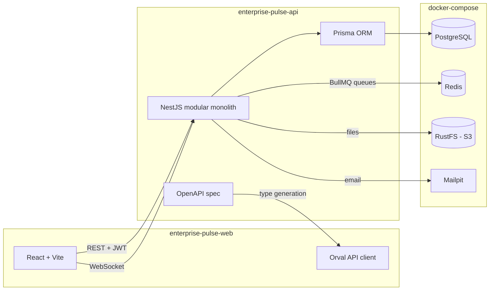
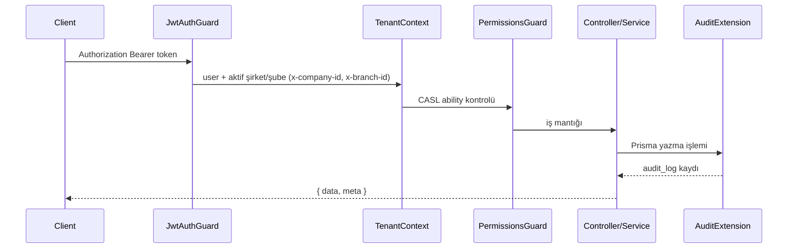

# Mimari

## Genel görünüm



## Backend: modüler monolit

- Her iş alanı `src/modules/<modül>` altında bağımsız bir NestJS modülüdür.
- Modüller birbirinin repository'sine / Prisma modellerine doğrudan dokunmaz; ya dışa açılan servis
  (`exports`) ya da domain event'leri (`@nestjs/event-emitter`) üzerinden konuşur.
- `src/common`: tüm modüllerin kullandığı guard, decorator, filter, interceptor, sayfalama yardımcıları.
- `src/infrastructure`: Prisma, Redis, kuyruk, dosya depolama, e-posta gibi teknik adaptörler.

### İstek yaşam döngüsü



### Çoklu şirket (tenant)

- Kiracıya bağlı her tabloda `companyId` bulunur.
- Kullanıcı bir veya daha fazla şirkete `UserCompany` ile bağlanır; rol atamaları şirket bazındadır.
- Aktif şirket `x-company-id` başlığıyla gelir; yoksa kullanıcının varsayılan şirketi kullanılır.
- `AsyncLocalStorage` tabanlı `RequestContext` mevcut kullanıcı, şirket ve şubeyi tüm katmanlara taşır.

### Yetkilendirme

- İzinler `module:action` biçimindedir (örn. `users:read`, `asset:assign`).
- Endpoint'ler `@RequirePermissions('users:create')` ile işaretlenir.
- `super-admin` rolü tüm izinlere sahiptir.

### Onay akışı (workflow) motoru

- `WorkflowDefinition` → sıralı `WorkflowStep`'ler (onaylayıcı: rol veya kullanıcı).
- Herhangi bir belge (`entityType` + `entityId`) için `WorkflowInstance` başlatılır.
- Her onay / ret `WorkflowAction` olarak kaydedilir; son adım onaylandığında
  `workflow.completed` event'i yayınlanır ve ilgili modül bunu dinler.

## Frontend: özellik bazlı yapı

```
src/
  app/          router, provider'lar, layout
  features/     her iş alanı: api, components, pages, hooks, schemas
  shared/       ui (shadcn), lib, hooks
  api/          http client + Orval tarafından üretilen kod
  i18n/         tr / en çeviri dosyaları
```

- Sunucu verisi yalnızca TanStack Query ile yönetilir; global istemci durumu (oturum, tema) Zustand'dadır.
- API tipleri backend'in OpenAPI şemasından Orval ile üretilir.
